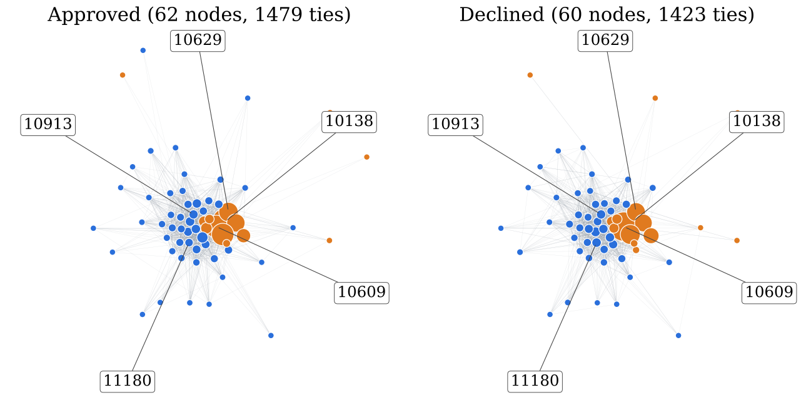

# Who Works With Whom? Collaboration Networks Behind Approved and Declined Loan Applications

Kübra Topçuoğlu, MA Digital Humanities and Digital Knowledge, 00001214604
Daria Talanova, MA Digital Humanities and Digital Knowledge, 0001213863
Maria Grigoryeva, MA Digital Humanities and Digital Knowledge, 0001213897
Aizana Kuular, MA Digital Humanities and Digital Knowledge, 0001215039

## 1. Introduction

The broad field of this project is organisational studies, and more specifically business informatics: the study of how organisations work and how information systems support their work. The particular application is process mining combined with social network analysis.

Information systems keep an *event log*. For every event, the log shows which task was done, on which case (for instance, a client request), who did it and when. Process mining uses these logs to see how work truly travels through an organisation. Van der Aalst and Song (2004) demonstrated that these same logs can also be converted into *social networks* of employees. Imagine employee A completes a task and employee B does the next task on the same case. Then A has passed the work on to B. If we combine all these handovers, we get a network of who works with whom. No one has to be interviewed or fill in a survey. We apply this concept to a public event log of loan applications at a Dutch financial institute (BPI Challenge 2012).

## 2. Problem and Motivation

Van der Aalst and Song (2004) introduced various metrics to extract social networks from event logs, such as *handover of work* and *working together*, but demonstrated them only on small illustrative examples. A follow-up study (van der Aalst, Reijers and Song, 2005) used the method on an actual log of a Dutch public works office and verified the results with its managers, but that log is private, so the study cannot be replicated. Both papers propose a further step that neither carries out: dividing cases into successful and unsuccessful ones and contrasting the social networks behind them.

We tackle two research questions:

- **RQ1.** What does the collaboration network of the bank look like? Who are the central employees, who are the brokers, and are there groups?
- **RQ2.** Among applications that reached the final review, do approved and declined applications show different collaboration patterns?

These questions are important for two reasons. In practice, if unsuccessful cases showed distinct collaboration patterns (for instance, more back-and-forth between co-workers, or reliance on a single person), managers could use this to restructure the process. From a theoretical standpoint, the question tests whether the outcome of a case leaves a mark in the social structure of the work, or whether that structure is a persistent property of the organisation.

Our principal contributions are:

1. We re-implement the methodology of van der Aalst and Song on a **public** dataset, with all code published, so that anyone can replicate the study.
2. We carry out the **approved vs. declined comparison** proposed as future work by both papers, via permutation tests (QAP and a label-permutation test).
3. We link network positions to **process roles** by examining which activities the central employees carry out.
4. Since PageRank divides a node's score by its out-degree, we **examine whether this normalisation is meaningful** for handover networks, and contrast PageRank with HITS.

## 3. Datasets

**Source.** We use the BPI Challenge 2012 event log (van Dongen, 2012). It is a electronic and public source. The banks workflow system recorded it between October 2011 and March 2012 while handling applications, so no digitisation was needed. It contains 13,087 loan applications (cases), 262,200 events and 68 resources with IDs. Because the official 4TU.ResearchData page was unavailable at download time, we obtained the file from a mirror on the GitLab server of CiTIUS, University of Santiago de Compostela (link in the repository README), checked that the numbers of cases, events and resources match the official ones and cite the official DOI.

**What an event looks like.** Each event contains a case ID, an activity name, a resource (employee), a timestamp and a lifecycle status. Activity names have three prefixes: `A_` for states of the application (submitted, declined, approved...), `O_` for states of the offer and `W_` for work items done by employees. The `W_` activities are in Dutch; for example, *W_Valideren aanvraag* means "validating the application" and *W_Nabellen offertes* means "calling the customer about the offer".
**Filtering (the boundary of the network).** The research question decides which nodes and cases belong to the network. We applied these rules in order:

1. We kept only `COMPLETE` events, so that one event equals one finished task (164,506 events).
2. We labelled every case by its outcome: *approved* if it contains `A_APPROVED`, *declined* if it contains `A_DECLINED`, *cancelled* if it contains `A_CANCELLED`, otherwise *open*.
3. We kept only cases that reached the final review step, defined as containing the activity *W_Valideren aanvraag*.
4. We kept only approved and declined cases.
5. We removed events without a resource (8,142 completed events in the full log) and the resource `112` (see below).
6. We drew the same number of cases from both groups (754 each, random seed 42).

Table 1 shows why step 3 is necessary. Every approved application went through the final review, but 90% of declined applications were rejected before it, most of them automatically, right after submission. These early rejections contain almost no human work; keeping them would make the "declined" network sparse only because its cases are short.

*Table 1. Cases by outcome and by whether they reached the final review.*

| Outcome | All cases | Reached final review |
|---|---|---|
| Approved | 2,246 | 2,246 |
| Declined | 7,635 | 754 |
| Cancelled | 2,807 | 158 |
| Open | 399 | 51 |

Cancellations are mostly the customer's own choice, not the bank's decision, so we left them out. We used all 754 declined cases and a random sample of 754 of the 2,246 approved ones, because a larger group would produce a denser network simply by containing more cases. Resource `112` records only automatic state changes (`A_SUBMITTED`, `A_PARTLYSUBMITTED`, `A_PREACCEPTED`, 4,065 events). These are actions of the system itself, and keeping them would add an artificial hub, so we removed this resource. The final dataset has 1,508 cases, 32,059 events and 62 employees.

**Building the networks.** The raw data is a two-mode structure (employees × cases). Following van der Aalst and Song (2004), we projected it into two kinds of one-mode employee networks:

- **Handover of work** (directed, weighted). There is a tie A → B if, within a case, a task done by A is directly followed by a task done by B. The weight is the share of all handovers that go from A to B. We removed self-loops (A followed by A) because they describe one person continuing their own work. They make up about two thirds of all direct successions.
- **Working together** (undirected). Following Definition 4.5 of the paper, the weight from A to B is the number of cases A and B share divided by the number of cases of A. We computed this ourselves, because PM4Py divides by the number of events instead. We symmetrised the weights by averaging the two directions. Since almost everybody shares at least one case with almost everybody, we dichotomised the network, keeping ties with weight ≥ 0.2 (on average, the two people share at least 20% of their cases). We repeat the analysis with a threshold of 0.1 as a robustness check.

Building both kinds for both groups gives the four networks analysed in this study (Table 2). We adopt a whole-network design: within the boundary above, all employees and all ties among them are included.

*Table 2. The four networks of the study. In all of them, a node is an employee.*

| Network | Shape | Edge (when it exists) | Direction / weight |
|---|---|---|---|
| Handover, approved | one-mode | A's task is directly followed by B's task in the same approved case | directed, weighted |
| Handover, declined | one-mode | same, in declined cases | directed, weighted |
| Working together, approved | one-mode | A and B share at least 20% of their approved cases | undirected, binary |
| Working together, declined | one-mode | same, in declined cases | undirected, binary |

**Tools.** We used Python: PM4Py to read the log and build the handover networks, pandas to filter and store the data, NetworkX and SciPy to compute measures and run the tests, Gephi to explore the networks, and Matplotlib for the figures. Data is stored as CSV edge lists and node tables, and as GEXF files for Gephi. The code, data and all result tables are in a public GitHub repository (https://github.com/Kubrato/network-analysis-bpi2012).

## 4. Validity and Reliability

**Validity.** 
Our network graph records all the collaboration that has been recorded. So a handover tie between two people means that they worked on the same case after each other for that case. It does not necessarily mean that they have been in contact with each other before. This would be an edge attribution error (Giallorenzo, n.d.; Borgatti, Everett and Johnson, 2018, Section 3.8) because we attribute a relation between two people based on the sequence of the tasks that they completed. A good check for secondary data is to ask the question of the survey that would be answered by that tie (Giallorenzo, n.d.). For a handover tie between A and B, that would be the question “From whom did you take over the work on this application?” This question would only ask about the workflow of the two people and not about whether they would have been in contact with each other before. As was found by van der Aalst et al. ( 2005) handover networks do match the way that managers perceive their organization.

Omission of important events (such as phone calls, meetings etc.) is also a problem, since the 8,142 completed events without a resource cannot be attributed. Moreover, node attribution errors, such as the person who records a decision (e.g. A_DECLINED) is not necessarily the person who made it (as in 67 of the 754 declined cases the person who recorded the decline was not the person who validated the application for decline) can also create ties that do not exist (commission errors). The network also partly captures the organization’s design as represented by the workflow management system for assigning tasks to workers (van der Aalst et al., 2005).

Note that our results are restricted to the applications that have reached the final review state. Hence, even after filtering for those applications that have been declined, on average the number of events for those cases is slightly lower than for the approved cases (median of 17 events for the declined cases compared to 21 events for the approved cases).

**Reliability.** We want to make sure that reliability is clear. The data is public and official counts can be verified. Every filtering and transformation rule is written in code and in this report. All random steps—such as the sample of approved cases, random graphs and permutations—use a fixed seed (42). Community detection originally varied between runs because it depends on order; we fixed this order, so results are the same every time. Anyone can reproduce our numbers by following the instructions in the repository.

**Ethics.** We keep the employees anonymised. The data was published for research. Still, a network can reveal individuals to people inside the organisation, so we describe roles and positions, not the quality of peoples work.

## 5. Measures and Results

Table 3 lists the measures we used, the phenomenon each one studies, and what it signifies in our networks (definitions follow Newman, 2018). To see whether a whole-network value is "special", we contrast it with 20 Erdős–Rényi random graphs G(n, m) with the same number of nodes and ties.

*Table 3. Applied measures, the phenomenon they investigate and their meaning in our networks.*

| Measure | Phenomenon | Meaning in our networks | RQ |
|---|---|---|---|
| Density, average degree | Cohesion | What share of all possible pairs of colleagues really pass work or share cases | 1, 2 |
| Components, diameter, average path length | Connectedness, reachability | Whether a case can get to every employee, and how many handovers it takes | 1 |
| Average clustering vs. random graphs, small-worldness σ = (C/C_rand)/(L/L_rand) | Local cohesion, small world | Whether employees form close groups joined by short paths | 1, 2 |
| Degree centralisation | Dominance of a few nodes | Whether the work relies on a small number of people | 1, 2 |
| Reciprocity | Mutual ties | Whether applications move in both directions instead of in one line | 1, 2 |
| Communities (greedy modularity), modularity Q | Groups | Whether teams match the steps of the process | 1 |
| Betweenness | Brokerage | Employees who move work from one step or group to another | 1, 2 |
| Closeness | Proximity | Employees who can reach everyone in a few handovers | 1 |
| HITS hub / authority | Sending / receiving in directed flows | Hubs send work on, authorities receive it at the end (decisions) | 1, 2 |
| Weighted PageRank | Flow-based importance | How much of its time a case spends with an employee | 1 |
| Eigenvector centrality | Prestige | Sharing cases with colleagues who are well connected themselves (working-together network) | 1 |
| QAP, label permutation, Spearman ρ | Similarity / difference between networks | Whether approved and declined cases are processed in a different way | 2 |

### 5.1 Whole-network measures (RQ1)

*Table 4. Whole-network measures (working-together threshold 0.2). Handover measures except density and reciprocity are computed on the undirected version.*

| Measure | Handover approved | Handover declined | Working together approved | Working together declined |
|---|---|---|---|---|
| Nodes | 62 | 60 | 62 | 60 |
| Ties | 1,479 | 1,423 | 487 | 449 |
| Density | 0.391 | 0.402 | 0.258 | 0.254 |
| Average degree | 31.4 | 31.1 | 15.7 | 15.0 |
| Components | 1 | 1 | 2 | 1 |
| Diameter | 3 | 3 | 3 | 4 |
| Average path length | 1.51 | 1.51 | 1.77 | 1.82 |
| Average clustering | 0.82 | 0.78 | 0.70 | 0.64 |
| Clustering of random graphs | 0.51 | 0.53 | 0.26 | 0.25 |
| σ (small-world) | 1.56 | 1.44 | 2.70 | 2.44 |
| Degree centralisation | 0.38 | 0.33 | 0.55 | 0.54 |
| Reciprocity | 0.69 | 0.69 | – | – |
| Communities / modularity | 2 / 0.17 | 2 / 0.20 | 6 / 0.13 | 5 / 0.13 |

**A small, tightly connected team.** In the handover network every employee belongs to one component, and any employee can reach any other in at most three hops (1.5 on average). The density of about 0.4 is considerably greater than the 0.225 observed by van der Aalst et al. (2005) in the public works office. The two processes are distinct, so we only observe that this bank team is highly interconnected.

**Work flows back and forth.** Reciprocity is 0.69: most handovers from A to B are mirrored by handovers from B to A. Work does not travel along an assembly line in one direction. Applications go back and forth between employees, for instance when a client has to be called again about missing documents.

**Small-world structure.** Clustering is markedly greater than in random graphs of the same size (0.82 vs. 0.51 in the approved handover network), while path lengths are almost the same. Both networks are small worlds (σ > 1). The effect is stronger in the working-together network (σ ≈ 2.4–2.7): once weak ties are discarded, individuals work in cohesive groups that are linked by short paths.

**Two blocks that follow the process.** The handover network divides into two communities. These communities are not random groups: one (44–48 individuals) includes the employees who process new applications and prepare offers, the other (14–16 individuals) includes the employees who validate applications and call clients about their dossiers (see Section 5.2). Modularity is low (0.17–0.20), so the border between the two blocks is weak: a lot of work traverses it, as it must, since every application passes from the first block to the second (Figure 1).

*Figure 1. Handover-of-work networks for approved (left) and declined (right) applications. Node size is HITS authority and colour is the community. The validators (orange) form the smaller block that receives work at the end of the process.*

**Some employees are more central.** Degree centralisation is modest in the handover network (0.33–0.38) and greater in the working-together network (0.54–0.55). A few individuals share cases with a sizeable part of the team. For instance, in the working-together network 11049 shares cases with 48 of the 61 other employees (approved) and 46 of the 59 others (declined), while the median employee has only 11–12 such ties.

### 5.2 Node measures: who is central, and why? (RQ1)

**Is PageRank meaningful here?** PageRank divides a node's importance by its out-degree, and this has to make sense for the relation in the network. We contend that it does for weighted handovers. When the weights are divided by the total weight leaving A, they turn into the probability that a case goes from A to B next, so PageRank can be read as the share of time a case spends with each employee while it travels through the team. Its weakest assumption is the random "jump" (15% of the time the case jumps to a random employee), which does not occur in reality. For the undirected working-together network, PageRank contributes little beyond degree, so we use eigenvector centrality there. PageRank and HITS authority provide almost the same rankings (Spearman ρ = 0.97 for approved, 0.96 for declined), and 8 of the top 10 employees are shared. Our conclusions thus do not rely on the out-degree normalisation.

*Table 5. Selected central employees.*

| Employee | Handover betweenness (appr. / decl.) | Authority (appr. / decl.) | PageRank (appr. / decl.) | Working-together betweenness (appr. / decl.) | Main activities |
|---|---|---|---|---|---|
| 10913 | **0.051** / 0.028 | 0.013 / 0.014 | 0.029 / 0.034 | – | completing applications, creating and sending offers |
| 11180 | 0.037 / 0.028 | 0.010 / 0.015 | 0.022 / 0.026 | – | completing applications, creating and sending offers |
| 10138 | 0.023 / 0.016 | **0.185** / 0.142 | 0.056 / 0.045 | 0.049 / – | validation, recording decisions |
| 10609 | 0.033 / 0.049 | 0.134 / **0.231** | 0.051 / **0.060** | – / 0.112 | validation, recording decisions |
| 10629 | 0.035 / **0.053** | 0.095 / 0.088 | 0.034 / 0.035 | – | validation, recording decisions |
| 11049 | – | – | **0.057** / 0.045 | **0.146 / 0.155** | calling customers, receiving returned offers |
| 10899 | – | – | 0.044 / 0.039 | 0.115 / 0.081 | calling customers, receiving returned offers |
| 11259 | – | – | 0.039 / 0.043 | 0.106 / 0.091 | calling customers, receiving returned offers |

**Other measures.** 11049 also has the greatest closeness in both handover networks (0.843 in both groups): they are only a few hops away from everyone. No one receives work from as many co-workers as they do (in-degree 50 for approved and 48 for declined cases). This is why their PageRank is high, while their handover betweenness is not. Numerous cases pass through them, but other employees are also connected by paths that do not go through them. In the working-together network, eigenvector centrality yields almost the same view as betweenness. The top three are 11049 (0.275), 10899 (0.260) and 11259 (0.250) for approved cases, and 11259 (0.262), 11049 (0.250) and 10913 (0.241) for declined cases.

The numbers only reveal *who* is central. To discover *why*, we checked which tasks these employees do. Three evident roles emerge:

1. **Front office (offer preparation): 10913, 11180.** They complete applications (*W_Completeren aanvraag*), create and send offers, and advance applications to the offer phase. In the approved network they have the greatest handover betweenness (in the declined network they are still in the top five, but behind 10629, 10609 and 10982): they are the conduit between the first contact with a client and the remainder of the process.
2. **Follow-up (customer contact): 11049, 10899, 11259.** Most of their work is calling clients about offers and about incomplete dossiers, and recording offers that clients send back (about 180–240 times each). They deal with many applications at distinct stages of the process. As a result, they share cases with numerous co-workers from distinct groups. This renders them the principal bridges in the working-together network. Their betweenness is two to three times greater than that of anyone else (Figure 2).
3. **Validators (final review and decision): 10138, 10609, 10972, 10629, 10809.** Their principal task is *W_Valideren aanvraag*. Together with one more colleague, six employees carry out about 95% of all validations. They also register the outcome events (approval or decline). In the handover network they are the authorities: work ends up with them. This fits the meaning of HITS: an authority receives work from numerous good hubs.

*Figure 2. Working-together networks (threshold 0.2) for approved (left) and declined (right) applications. Node size is betweenness and colour is the community. The follow-up employees 11049, 10899 and 11259 are the main bridges.*

This is how data, measures and properties are connected: the structure of the network follows the stages of the loan process. Each stage (preparing offers, following up with clients, validating) has its own central individuals. The two handover communities match these stages.

### 5.3 Approved vs. declined applications (RQ2)

We looked at the difference between the two groups in three ways.

**QAP correlation (dyadic level).** We calculated the correlation between the two handover adjacency matrices and then compared it to the correlations we would have obtained from 5,000 random relabellings of one of the matrices. In each of the relabellings the rows and columns are shuffled together. This preserves the structure of the network but breaks the link between the labels. H0: the two networks are no more similar than would be expected by chance.

**Label-permutation test (whole-network level).** We randomly permuted the "approved" and "declined" labels amongst the 1,508 cases 500 times. In each instance we rebuilt both (unweighted) handover networks. We then counted how many of those 500 permutations produced a random difference in density, reciprocity, clustering and centralisation that was at least as large as the observed difference. H0: the outcome of a case has no effect on any of these measures.

**Rank correlation of betweenness (node level).** For the employees who occur in both groups, we correlated their betweenness rankings with Spearman's ρ.

*Table 6. Tests comparing approved and declined applications.*

| Test | Value | p-value |
|---|---|---|
| QAP, weighted handover | r = 0.84 | 0.0002 |
| QAP, binary handover | r = 0.61 | 0.0002 |
| Difference in density (approved − declined) | −0.011 | 0.58 |
| Difference in reciprocity | −0.001 | 0.94 |
| Difference in average clustering | +0.042 | 0.08 |
| Difference in degree centralisation | +0.053 | 0.10 |
| Spearman ρ, handover betweenness | 0.90 | < 0.001 |
| Spearman ρ, working-together betweenness | 0.77 | < 0.001 |

The two handover networks are extremely similar, and this similarity is significant (QAP r = 0.84, p = 0.0002, the smallest possible p-value with 5,000 permutations). There is no significant difference between the whole networks at the 5% level. The approved network is only slightly more clustered and more centralised (p = 0.08 and 0.10), which is at most a very weak trend. The same people are central in both groups (ρ = 0.90 and 0.77). The handover communities are made up of almost the same individuals.

We see only one difference, and it is among the validators at the end of the process. The groups are the same size, so we can compare the counts directly. 10609 records 27% of declines but only 16% of approvals, while 10138 records 30% of approvals and 21% of declines. This partly explains why 10609 is the dominant authority in the declined network and 10138 in the approved one. We can describe the pattern, but we cannot say what causes it. 10609 may be getting more complex dossiers, may be more senior, or may simply be recording decisions made by others. The log does not tell us which is the case.

### 5.4 Robustness check

We also tried a working-together threshold of 0.1 rather than 0.2. As expected, the network becomes a lot denser (0.56–0.59), has fewer communities (3) and a much weaker small-world effect (σ ≈ 1.4). The main results are unchanged. The approved and declined networks are still extremely similar (working-together betweenness ρ = 0.91), and 11049 is still the key bridge in both groups. The betweenness values are now much more even, with the highest value dropping from around 0.15 to 0.03. This is because in a denser network most individuals are directly linked, so the other follow-up employees lose their special status (10899 is 5th/3rd, 11259 is 8th/6th). The handover results are not dependent on this threshold.

## 6. Conclusion

The bank's collaboration network (RQ1) is a compact, closely knit team of around 60 people. And it is structured according to the stages of the lending process. Work tends to go back and forth between co-workers rather than along a straight line. So, the network has a small-world structure where cohesive working groups are linked by short paths. Each step is built around its own central individuals. A few front-office employees forward applications to the rest of the team and a few follow-up employees are the bridges between groups since they are the only ones who are engaged in most cases. Then a small group of six validators receives the work at the end and registers the decisions. On their own, network measures only indicated who is central. Combining them with the activity profiles explained why.

Among applications that reached the final review (RQ2), we did not detect significantly distinct collaboration patterns. Approved and declined applications are processed by the same people, in the same groups, distributing the work in the same way. This leads us to the conclusion that the outcome of an application depends on the application itself more than on who works on it and how they work together. The only difference that could be noticed is in which validator registers the decision, which merits a more detailed examination but cannot be construed as a cause with our data.

This "null result" is useful, since it shows that the collaboration structure is a persistent property of the organisation. It means that it is not something that varies with the outcome of a case. Restructuring the process means that the reasons for rejecting applications should be sought in the cases themselves and the decision-making rules, rather than in the interactions between employees.

## 7. Critique

**To what extent are the problems solved?** RQ1 is addressed well: the measures characterise the structure of the network, and the activity profiles clarify the role of the central employees. However, the roles were derived from the same log, not from an independent source such as an organisation chart, so the match between network positions and roles is credible but not independently validated. RQ2 is addressed only partially. We observed no significant difference in the measures we examined, with 754 cases per group, but we cannot say that no difference is present. A null result depends on the power of the tests, and we did not quantify how big a difference our design could identify.

**What we could have done differently.**

- **Validating ties and decisions.** Section 4 describes the principal validity limitations: unofficial collaboration is not in the log, and the person who registers a decision may not be the one who made it. Interviews or a survey of employees could validate the ties, as van der Aalst et al. (2005) did with managers. Data on formal roles would uncover who actually makes the decision, and would provide an independent attribute to test homophily (do employees with the same role work together more?).
- **Edge definition.** A handover considers only direct succession and disregards how long the case remained idle in between: a handover after five minutes and one after five days are the same tie. Weighting ties by time, or applying other metrics introduced by van der Aalst and Song (for instance subcontracting), could uncover differences that direct succession conceals.
- **One sample.** We used one random sample of approved applications. Replicating the analysis with numerous samples would uncover how robust the numbers are.
- **Limited tests.** The permutation test included four whole-network measures on the unweighted handover network. Weighted measures, or a node-level test for the validators, could uncover smaller effects. The clustering difference (p = 0.08) could prove significant with more data.
- **Time.** We regarded six months as one network. Teams and workload may shift, and a series of monthly networks would uncover this.
- **Other models.** Case attributes, such as the amount requested, could be incorporated to test whether case charac◊teristics forecast the outcome better than the collaboration structure. Exponential random graph models (ERGM) could test various effects simultaneously.
- **Thresholds.** We examined two working-together thresholds (Section 5.4). A wider range would make this result more robust.

In spite of these limitations, the study shows that the method of van der Aalst and Song is applicable to a large public log and can be completely replicated, and that it uncovers an evident and interpretable structure of work.

## References

van der Aalst, W. M. P., & Song, M. (2004). Mining social networks: Uncovering interaction patterns in business processes. In *Business Process Management (BPM 2004)*, LNCS 3080, 244–260. Springer.

van der Aalst, W. M. P., Reijers, H. A., & Song, M. (2005). Discovering social networks from event logs. *Computer Supported Cooperative Work*, 14(6), 549–593. https://doi.org/10.1007/s10606-005-9005-9

van Dongen, B. F. (2012). *BPI Challenge 2012* [Data set]. 4TU.ResearchData. https://doi.org/10.4121/uuid:3926db30-f712-4394-aebc-75976070e91f

Berti, A., van Zelst, S. J., & van der Aalst, W. M. P. (2019). Process Mining for Python (PM4Py): Bridging the gap between process- and data science. *ICPM Demo Track*. arXiv:1905.06169

Borgatti, S. P., Everett, M. G., & Johnson, J. C. (2018). *Analyzing Social Networks* (2nd ed.). SAGE.

Giallorenzo, S. (n.d.). *Research design (also, how to read a research paper)* [Lecture slides]. Network Analysis, MA Digital Humanities and Digital Knowledge, University of Bologna.

Hagberg, A., Schult, D., & Swart, P. (2008). Exploring network structure, dynamics, and function using NetworkX. *Proceedings of the 7th Python in Science Conference*, 11–15.

Newman, M. E. J. (2018). *Networks* (2nd ed.). Oxford University Press.
