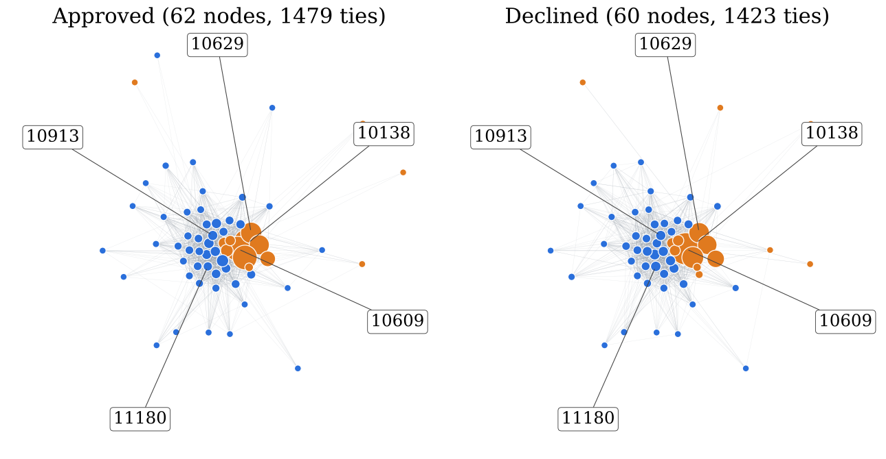
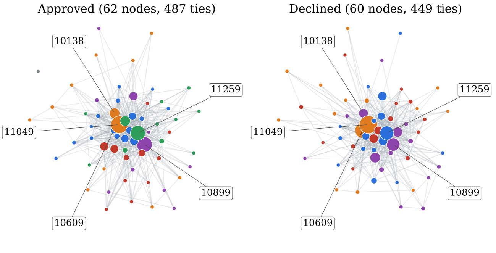

# Who Works With Whom? Collaboration Networks Behind Approved and Declined Loan Applications

Kübra Topçuoğlu, MA Digital Humanities and Digital Knowledge, [matricola]
Daria Talanova, MA Digital Humanities and Digital Knowledge, [matricola]
Maria Grigoryeva, MA Digital Humanities and Digital Knowledge, [matricola]
Aizana Kuular, MA Digital Humanities and Digital Knowledge, [matricola]

## 1. Introduction

The general field of this project is organisational studies, and more precisely business informatics: the study of how organisations work and how information systems support their work. The specific application is process mining combined with social network analysis.

Most organisations today run their daily work through information systems. These systems keep an *event log*: a record of which task was done, on which case (for example, a customer request), by whom, and when. Process mining uses these logs to rebuild how work really flows through an organisation, which is often different from how managers think it flows. Van der Aalst and Song (2004) showed that the same logs can also be used to build *social networks* of employees. If employee A finishes a task and employee B does the next task on the same case, then A has handed work over to B. Collecting all these handovers gives a network of who works with whom, without asking anyone a single question.

We apply this idea to a real, public event log of loan applications at a Dutch financial institute (BPI Challenge 2012). We build two kinds of employee networks and study them with the measures of the course.

## 2. Problem and Motivation

Van der Aalst and Song (2004) proposed several metrics to derive social networks from event logs, such as *handover of work* and *working together*. Their paper only shows the method on small examples. A follow-up study (van der Aalst, Reijers and Song, 2005) applied the method to a real log of a Dutch public works office and checked the results with its managers, but that log is confidential, so the study cannot be repeated by others. In their conclusions, both papers suggest a further step that neither of them carries out: splitting cases into successful and unsuccessful ones and comparing the social networks behind them.

We address two research questions:

- **RQ1.** What does the collaboration network of the bank look like? Who are the central employees, who are the brokers, and are there groups?
- **RQ2.** Among applications that reached the final review, do approved and declined applications show different collaboration patterns?

These questions matter for two reasons. From a practical point of view, if failed cases followed different collaboration patterns (for example, more back-and-forth between colleagues, or dependence on a single person), managers could use this to redesign the process. From a theoretical point of view, the question tests whether the outcome of a case leaves a trace in the social structure of the work, or whether the structure is a stable property of the organisation.

Our main contributions are:

1. We reproduce the approach of van der Aalst and Song on a **public** dataset, with all code published, so that anyone can repeat the study.
2. We carry out the **approved vs. declined comparison** suggested as future work by both papers, using permutation tests (QAP and a label-permutation test).
3. We connect network positions to **process roles** by looking at which activities the central employees perform.
4. Following our teacher's remark on PageRank, we **check whether PageRank's out-degree normalisation makes sense** for handover networks, and compare it with HITS.

## 3. Datasets

**Source.** We use the BPI Challenge 2012 event log (van Dongen, 2012), published on 4TU.ResearchData. It is a secondary, electronic source: the data was not collected for network research, but recorded by the bank's workflow system between October 2011 and March 2012. It contains 13,087 loan applications (cases), 262,200 events and 68 resources. Employee IDs are anonymised numbers. The official 4TU page was not available when we downloaded the data, so we downloaded the file from a mirror on the GitLab server of CiTIUS, University of Santiago de Compostela (the same address used by the Verona process mining library; the full link is in the README). We checked it against the official numbers (cases, events, resources); all matched. We cite the official DOI.

**What an event looks like.** Each event has a case ID, an activity name, a resource (employee), a timestamp and a lifecycle status. Activity names start with three prefixes: `A_` for states of the application (submitted, declined, approved...), `O_` for states of the offer sent to the customer, and `W_` for work items done by employees. The `W_` activities are in Dutch; for example, *W_Valideren aanvraag* means "validating the application" and *W_Nabellen offertes* means "calling the customer about the offer".

**Filtering (the boundary of the network).** The research question decides which nodes and cases belong to the network. We applied the following rules, in this order:

1. We kept only `COMPLETE` events, so that one event equals one finished task (164,506 events).
2. We labelled every case by its outcome: *approved* if it contains `A_APPROVED`, *declined* if it contains `A_DECLINED`, *cancelled* if it contains `A_CANCELLED`, otherwise *open*.
3. We kept only cases that reached the final review step, defined as containing the activity *W_Valideren aanvraag*.
4. We kept only approved and declined cases.
5. We removed events without a resource (8,142 events in the full log) and the resource `112` (see below).
6. We drew the same number of cases from both groups (754 each, random seed 42).

Table 1 shows why step 3 is necessary. Every approved application went through the final review, but 90% of declined applications were rejected before it, most of them automatically, right after submission. These early rejections contain almost no human work. Had we kept them, the "declined" network would have looked sparse only because those cases are short, not because people collaborate differently.

*Table 1. Cases by outcome and by whether they reached the final review.*

| Outcome | All cases | Reached final review |
|---|---|---|
| Approved | 2,246 | 2,246 |
| Declined | 7,635 | 754 |
| Cancelled | 2,807 | 158 |
| Open | 399 | 51 |

We compare approved with declined applications only. Cancellations are mostly the customer's own choice, not the bank's decision, so they answer a different question. Since only 754 declined applications reached the final review, we used all of them and a random sample of 754 of the 2,246 approved ones. Equal groups matter because a larger group would produce a denser network just because it contains more cases.

Resource `112` records 4,065 events, more than any employee. All of them are automatic state changes (`A_SUBMITTED`, `A_PARTLYSUBMITTED`, `A_PREACCEPTED`), and it records every submission. It is the system, not a person, so we removed it; left in, it would appear as an artificial hub. The final dataset has 1,508 cases, 32,059 events and 62 employees (62 in the approved group, 60 in the declined group).

**Building the networks.** The raw data is a two-mode structure (employees × cases). We turned it into two one-mode employee networks per group, following the definitions of van der Aalst and Song (2004):

- **Handover of work** (directed, weighted). There is a tie A → B if, within a case, a task done by A is directly followed by a task done by B. The weight is the share of all handovers that go from A to B. Self-loops (A followed by A) are removed: they describe one person continuing their own work, not collaboration. They are, however, very common: about two thirds of all direct successions stay with the same person.
- **Working together** (undirected, weighted). Following Definition 4.5 of the paper, the weight from A to B is the number of cases A and B share divided by the number of cases of A. We computed this ourselves, because PM4Py divides by the number of events, which gives values that are hard to interpret. Since this measure is not symmetric, we symmetrised it by averaging the two directions. Almost everybody shares at least one case with almost everybody, so we dichotomised the network and kept only ties with weight ≥ 0.2 (on average, the two people share at least 20% of their cases). We report a threshold of 0.1 as a robustness check.

We adopt a whole-network design: within the boundary above, all employees and all ties among them are included.

**Tools.** We used Python: PM4Py to read the log and build the handover networks, pandas to filter and store the data, NetworkX and SciPy to compute measures and run the tests, Gephi to explore the networks, and Matplotlib for the figures in this report. Data is stored as CSV edge lists and node tables, and as GEXF files for Gephi. The code, the data and all result tables are in a public GitHub repository (https://github.com/Kubrato/network-analysis-bpi2012).

## 4. Validity and Reliability

**Validity.** Our networks show *recorded* collaboration only. A handover tie means that two people worked on the same case one after the other; it does not prove that they talked to each other. This is the edge attribution problem discussed in class: we assume a relation from a sequence of tasks. On the other hand, a handover is a real dependency in the work, since B can only continue once A has finished. Van der Aalst, Reijers and Song (2005) found that handover networks matched what managers knew about their organisation, which supports this reading.

There are also omission errors. Phone calls, meetings and informal help between colleagues are not in the log. The 8,142 events without a resource are also lost; we cannot know who did them. Commission errors are possible as well: the person who *records* a decision (for example `A_DECLINED`) is not necessarily the person who *made* it. Finally, as van der Aalst et al. (2005) warn, when a workflow system assigns tasks, the network partly reflects the design of the system and not only the choices of people.

Our filter is a conscious boundary decision with a cost. Our results hold for applications that reached the final review, not for all applications. Even after filtering, declined applications are a little shorter than approved ones (median 17 vs. 21 events per case), which we keep in mind when we interpret differences.

**Reliability.** The data is public and the official numbers can be checked (13,087 cases, 262,200 events, 68 resources). Every filtering and transformation rule is written in the code and in this report. All random steps use a fixed seed (42): the sample of approved cases, the random graphs and the permutations. We also found that the community detection gave slightly different results from run to run, because it depends on the order in which nodes are added; we fixed this order, so the results are now identical every time. Anyone can download the repository and get exactly our numbers with three commands (see the README).

**Ethics.** The employees are anonymised and the data was published for research. Still, a network can reveal individuals to people inside the organisation. For this reason we describe roles and positions, not the quality of individual people's work.

## 5. Measures and Results

### 5.1 Whole-network measures (RQ1)

We start with measures that describe the overall shape of each network (Table 2). To see whether a value is "special", we compare it with 20 Erdős–Rényi random graphs G(n, m) with the same number of nodes and ties. Small-worldness is σ = (C / C_random) / (L / L_random), where C is the average clustering and L the average path length; σ > 1 means a small-world network. Communities were found with greedy modularity maximisation; modularity Q measures how much more often ties fall inside groups than expected at random.

*Table 2. Whole-network measures (working-together threshold 0.2). Handover measures except density and reciprocity are computed on the undirected version.*

| Measure | Handover approved | Handover declined | Working together approved | Working together declined |
|---|---|---|---|---|
| Nodes | 62 | 60 | 62 | 60 |
| Ties | 1,479 | 1,423 | 487 | 449 |
| Density | 0.391 | 0.402 | 0.258 | 0.254 |
| Average degree | 31.4 | 31.1 | 15.7 | 15.0 |
| Components | 1 | 1 | 2 | 1 |
| Diameter | 3 | 3 | 3 | 4 |
| Average path length | 1.51 | 1.51 | 1.77 | 1.82 |
| Average clustering | 0.82 | 0.78 | 0.70 | 0.64 |
| Clustering of random graphs | 0.51 | 0.53 | 0.26 | 0.25 |
| σ (small-world) | 1.56 | 1.44 | 2.70 | 2.44 |
| Degree centralisation | 0.38 | 0.33 | 0.55 | 0.54 |
| Reciprocity | 0.69 | 0.69 | – | – |
| Communities / modularity | 2 / 0.17 | 2 / 0.20 | 6 / 0.13 | 5 / 0.13 |

**A small, tightly connected team.** In the handover network every employee belongs to one component, and any employee can reach any other in at most three steps (1.5 on average). The density of about 0.4 is much higher than the 0.225 found by van der Aalst et al. (2005) in the public works office. The two processes are different, so we only note that this bank team is very interconnected.

**Work flows back and forth.** Reciprocity is 0.69: most handovers from A to B are matched by handovers from B to A. Work does not move along an assembly line in one direction; applications go back and forth between employees, for example when a customer has to be called again about missing documents.

**Small-world structure.** Clustering is clearly higher than in random graphs of the same size (0.82 vs. 0.51 in the approved handover network), while path lengths are almost the same. Both networks are small worlds (σ > 1). The effect is stronger in the working-together network (σ ≈ 2.4–2.7): once weak ties are removed, people work in tight groups that are linked by short paths.

**Two blocks that follow the process.** The handover network splits into two communities. These communities are not random groups: one (44–48 people) contains the employees who handle new applications and prepare offers, the other (14–16 people) contains the employees who validate applications and call customers about their files (see Section 5.2). Modularity is low (0.17–0.20), so the boundary between the two blocks is weak: a lot of work crosses it, as it must, since every application passes from the first block to the second (Figure 1).

*Figure 1. Handover-of-work networks for approved (left) and declined (right) applications. Node size is HITS authority; colour is the community. The validators (orange) form the smaller block that receives work at the end of the process.*

**Some employees are more central.** Degree centralisation is moderate in the handover network (0.33–0.38) and higher in the working-together network (0.54–0.55). A few people share cases with a large part of the team. For example, in the working-together network 11049 shares cases with 48 of the 61 other employees (approved) and 46 of the 59 others (declined), while the median employee has only 11–12 such ties.

### 5.2 Node measures: who is central, and why? (RQ1)

For each employee we computed:

- **Betweenness**: how often a person lies on the shortest paths between two others. High values mark brokers who connect parts of the network.
- **Closeness**: how close a person is to everyone else on average.
- **HITS** (hubs and authorities): in a directed network, a good *authority* receives work from good hubs, and a good *hub* passes work to good authorities.
- **Weighted PageRank**: a person's importance, passed on to the people they hand work to.
- **Eigenvector centrality** for the undirected working-together network: a person is important if they work with important people.

**A note on PageRank.** Our teacher pointed out that PageRank divides a node's importance by its out-degree, and that this has to make sense for the relation in the network. We think it does for weighted handovers. When the weights are divided by the total weight leaving A, they become the probability that a case goes from A to B next. PageRank can then be read as the share of time a case spends with each employee while it moves through the team. Its weakest assumption is the random "jump" (15% of the time the case jumps to a random employee), which does not happen in reality. For the undirected working-together network, PageRank adds little to degree, so we use eigenvector centrality there. We also compared PageRank with HITS authority: the rankings are almost the same (Spearman ρ = 0.97 for approved, 0.96 for declined), and 8 of the top 10 employees are shared. Our conclusions therefore do not depend on the out-degree normalisation.

*Table 3. Selected central employees.*

| Employee | Handover betweenness (appr. / decl.) | Authority (appr. / decl.) | PageRank (appr. / decl.) | Working-together betweenness (appr. / decl.) | Main activities |
|---|---|---|---|---|---|
| 10913 | **0.051** / 0.028 | 0.013 / 0.014 | 0.029 / 0.034 | – | completing applications, creating and sending offers |
| 11180 | 0.037 / 0.028 | 0.010 / 0.015 | 0.022 / 0.026 | – | completing applications, creating and sending offers |
| 10138 | 0.023 / 0.016 | **0.185** / 0.142 | 0.056 / 0.045 | 0.049 / – | validation, recording decisions |
| 10609 | 0.033 / 0.049 | 0.134 / **0.231** | 0.051 / **0.060** | – / 0.112 | validation, recording decisions |
| 10629 | 0.035 / **0.053** | 0.095 / 0.088 | 0.034 / 0.035 | – | validation, recording decisions |
| 11049 | – | – | **0.057** / 0.045 | **0.146 / 0.155** | calling customers, receiving returned offers |
| 10899 | – | – | 0.044 / 0.039 | 0.115 / 0.081 | calling customers, receiving returned offers |
| 11259 | – | – | 0.039 / 0.043 | 0.106 / 0.091 | calling customers, receiving returned offers |

**Other measures.** 11049 also has the highest closeness in both handover networks (0.843 in both groups): they are only a few steps away from everyone. They receive work from more colleagues than anyone else (in-degree 50 approved, 48 declined), which is why their PageRank is high even though their handover betweenness is not: many cases pass through them, but they are not the only path between other people. In the working-together network, eigenvector centrality gives almost the same picture as betweenness. The top three are 11049 (0.275), 10899 (0.260) and 11259 (0.250) for approved cases, and 11259 (0.262), 11049 (0.250) and 10913 (0.241) for declined cases.

The numbers alone tell us *who* is central. To understand *why*, we looked at which activities these employees perform. Three clear roles appear:

1. **Front office (offer preparation): 10913, 11180.** They complete applications (*W_Completeren aanvraag*), create and send offers, and move applications to the offer stage. In the approved network they have the highest handover betweenness (in the declined network they are still in the top five, but behind 10629, 10609 and 10982): they are the passage between the first contact with a customer and the rest of the process.
2. **Follow-up (customer contact): 11049, 10899, 11259.** Most of their work is calling customers about offers and about incomplete files, and recording offers that customers send back (about 180–240 times each). They touch many applications at different stages, so they share cases with many colleagues from different groups. This makes them the main bridges in the working-together network, with betweenness two to three times higher than anyone else (Figure 2).
3. **Validators (final review and decision): 10138, 10609, 10972, 10629, 10809.** Their main task is *W_Valideren aanvraag*. Together with one more colleague, six employees perform about 95% of all validations. They also record the outcome events (approval or decline). In the handover network they are the authorities: work ends up with them. This matches the meaning of HITS: an authority receives work from many good hubs.

*Figure 2. Working-together networks (threshold 0.2) for approved (left) and declined (right) applications. Node size is betweenness; colour is the community. The follow-up employees 11049, 10899 and 11259 are the main bridges.*

This is the key link between data, measures and properties: the shape of the network reflects the stages of the loan process. Offer preparation, customer follow-up and validation each have their own central people, and the two handover communities correspond to these stages.

### 5.3 Approved vs. declined applications (RQ2)

We tested the difference between the two groups in three ways.

**QAP correlation (dyadic level).** We correlated the two handover adjacency matrices and compared the result with 5,000 random relabellings of one of them (the rows and columns are shuffled together, which keeps the structure of the network but breaks the link between labels). H0: the two networks are not more similar than random.

**Label-permutation test (whole-network level).** We shuffled the labels "approved" and "declined" among the 1,508 cases 500 times, rebuilt both handover networks each time, and checked how often the random difference in density, reciprocity, clustering and centralisation was as large as the real one. H0: the outcome of a case does not change these measures.

**Rank correlation of betweenness (node level).** We compared the betweenness rankings of the employees that appear in both groups with Spearman's ρ.

*Table 4. Tests comparing approved and declined applications.*

| Test | Value | p-value |
|---|---|---|
| QAP, weighted handover | r = 0.84 | 0.0002 |
| QAP, binary handover | r = 0.61 | 0.0002 |
| Difference in density (approved − declined) | −0.011 | 0.58 |
| Difference in reciprocity | −0.001 | 0.94 |
| Difference in average clustering | +0.042 | 0.08 |
| Difference in degree centralisation | +0.053 | 0.10 |
| Spearman ρ, handover betweenness | 0.90 | < 0.001 |
| Spearman ρ, working-together betweenness | 0.77 | < 0.001 |

The two handover networks are strongly and significantly similar (QAP r = 0.84; 0.0002 is the smallest p-value possible with 5,000 permutations). None of the whole-network differences is significant at the 5% level. The approved network is slightly more clustered and more centralised (p = 0.08 and 0.10), which we report only as a weak tendency. The same employees are central in both groups (ρ = 0.90 and 0.77), and the handover communities contain almost exactly the same people.

The one visible difference is at the end of the process, among the validators. Since the groups have the same size, we can compare counts directly. Employee 10609 records 27% of declines but 16% of approvals, while 10138 records 30% of approvals and 21% of declines. This explains why 10609 is the strongest authority in the declined network and 10138 in the approved one. This is a description, not an explanation: 10609 may receive harder files, may be more senior, or may simply record decisions taken by others. The log does not tell us which.

### 5.4 Robustness check

With a working-together threshold of 0.1 instead of 0.2, the network is much denser (0.56–0.59), has fewer communities (3) and a weaker small-world effect (σ ≈ 1.4), as expected. However, the main findings do not change: approved and declined networks remain very similar (betweenness ρ = 0.91), and the same follow-up employees remain the main bridges. The handover results do not depend on this threshold.

## 6. Conclusion

The collaboration network of the bank (RQ1) is a small, tightly connected team of about 60 people, organised along the stages of the loan process. Work moves back and forth between colleagues rather than along a straight line, and the network has a small-world structure: tight working groups joined by short paths. Each stage has its own central people. A few front-office employees pass applications on to the rest of the team, a few follow-up employees are the bridges between groups because they are involved in so many cases, and a small group of six validators receives the work at the end and records the decisions. Network measures alone only told us who is central; combining them with the activity profiles told us why.

Among applications that reached the final review (RQ2), we did not find significantly different collaboration patterns. Approved and declined applications are handled by the same people, in the same groups, passing work in the same way. This suggests that the outcome of an application depends on the application itself (the customer, the amount, the documents) more than on who works on it and how they work together. The only visible difference is in which validator records the decision, which deserves a closer look but cannot be interpreted as a cause with our data.

This "null result" is useful in itself. It indicates that the collaboration structure is a stable property of the organisation and not something that changes with the outcome of a case. For process redesign, it means that the reasons for declined applications should be looked for in the cases and in the decision rules, not in the collaboration between employees.

## 7. Critique

Our work answers RQ1 well: we describe the structure of the network and, through activity profiles, explain the role of the central employees. It answers RQ2 only partly. We can say that we found no significant difference in the measures we tested, with 754 cases per group; we cannot say that no difference exists. Several choices limit our conclusions:

- **Recorded work only.** Handover and working-together ties come from the log. Informal collaboration, which might differ between difficult and easy cases, is invisible. Interviews or a survey of employees would be needed to validate the ties, as van der Aalst et al. (2005) did with managers.
- **Who decides?** The person who records `A_DECLINED` may not be the one who makes the decision. Information about formal roles or team membership would allow us to test this.
- **One sample.** We used one random sample of approved applications. Repeating the analysis with many samples would show how stable the numbers are.
- **Limited tests.** The permutation test covered four whole-network measures on the unweighted handover network. Weighted measures, or a test of node-level differences for the validators, could reveal smaller effects. The clustering difference (p = 0.08) might become significant with more data.
- **Time.** We treated six months as one network. Teams and workload may change over time; a sequence of monthly networks would show this.
- **Other models.** Case attributes, such as the amount requested, could be added to test whether case features predict the outcome better than the collaboration structure. Exponential random graph models (ERGM) could test several effects at the same time.
- **Thresholds.** The working-together network depends on the threshold. We checked two values (0.1 and 0.2); a wider range would make this result stronger.

Despite these limits, the study shows that the method of van der Aalst and Song works on a large public log and can be fully reproduced, and that it reveals a clear and interpretable structure of work.

## References

van der Aalst, W. M. P., & Song, M. (2004). Mining social networks: Uncovering interaction patterns in business processes. In *Business Process Management (BPM 2004)*, LNCS 3080, 244–260. Springer.

van der Aalst, W. M. P., Reijers, H. A., & Song, M. (2005). Discovering social networks from event logs. *Computer Supported Cooperative Work*, 14(6), 549–593. https://doi.org/10.1007/s10606-005-9005-9

van Dongen, B. F. (2012). *BPI Challenge 2012* [Data set]. 4TU.ResearchData. https://doi.org/10.4121/uuid:3926db30-f712-4394-aebc-75976070e91f

Berti, A., van Zelst, S. J., & van der Aalst, W. M. P. (2019). Process Mining for Python (PM4Py): Bridging the gap between process- and data science. *ICPM Demo Track*. arXiv:1905.06169

Hagberg, A., Schult, D., & Swart, P. (2008). Exploring network structure, dynamics, and function using NetworkX. *Proceedings of the 7th Python in Science Conference*, 11–15.
